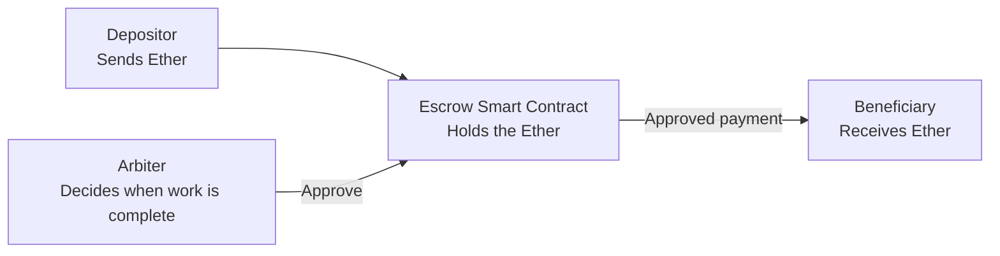
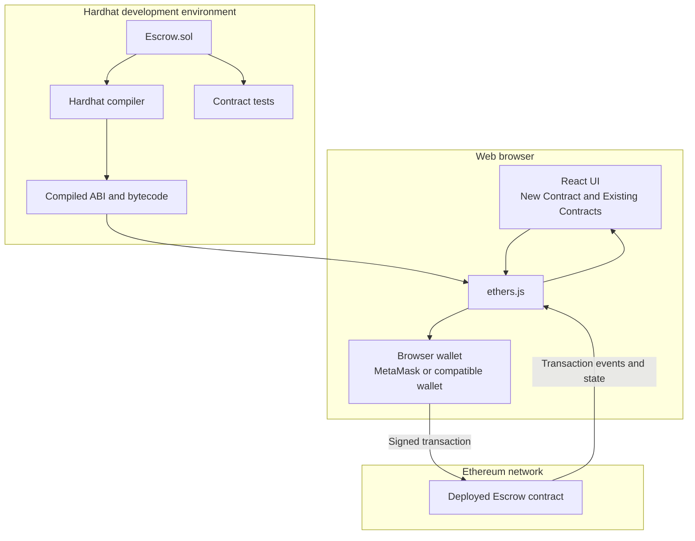
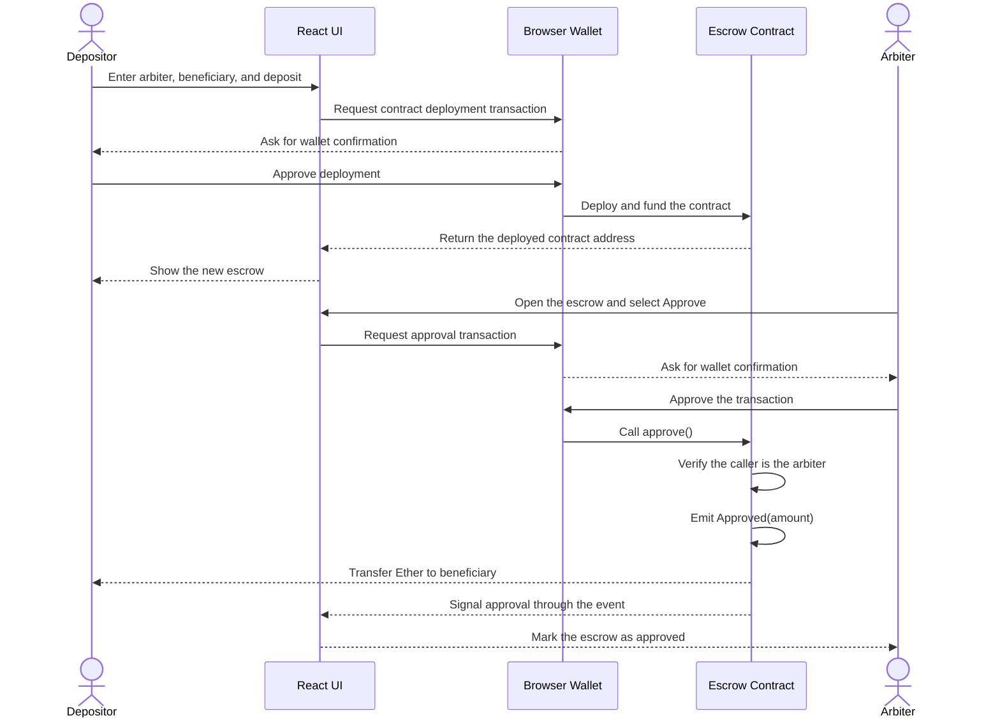

# Architecture

## What is this application?

This project is a **decentralized escrow application (dapp)**: a web page that helps two people complete an exchange without requiring a human middleman to hold the payment.

In simple terms:

1. A **depositor** sends Ether into a smart contract.
2. The Ether stays inside that contract until a decision is made.
3. A trusted **arbiter** approves the transaction.
4. The contract automatically sends the Ether to the **beneficiary**.

The contract—not a traditional server—holds and transfers the money according to rules written in code.



## Why it is a dapp

A dapp combines a user interface with a blockchain application:

| Part | Role | Traditional equivalent |
|---|---|---|
| React web app | Lets people enter addresses and make a payment | Customer-facing website |
| Browser wallet | Confirms the depositor's identity and signs transactions | Bank or account login |
| Ethereum smart contract | Holds Ether and enforces escrow rules | Escrow account plus its written terms |
| Blockchain | Records transactions and contract state | Public, shared transaction ledger |

No central application server sends the payment. The escrow contract is deployed to the blockchain, and anyone allowed by the contract's rules can interact with it through a wallet.

## The three participants

### Depositor

The person or wallet that creates the escrow contract and funds it. The depositor's address is recorded automatically when the contract is deployed.

### Beneficiary

The person or wallet that should receive the funds. The depositor chooses this address during contract creation.

### Arbiter

A trusted third party who decides whether the transaction should be approved. Only this address can call `approve()`. This prevents the beneficiary or a random wallet from releasing the funds without approval.

## System architecture



## Repository structure

| Location | Purpose |
|---|---|
| `contracts/Escrow.sol` | The escrow smart contract and its approval rules |
| `test/test.js` | Hardhat tests for funding and authorization behavior |
| `hardhat.config.js` | Solidity version and compiled-artifact output configuration |
| `app/src/App.js` | Wallet connection, contract creation, and React state |
| `app/src/deploy.js` | Uses the contract ABI and bytecode to deploy a new escrow |
| `app/src/Escrow.js` | Displays an escrow and its Approve button |
| `app/src/artifacts/contracts/Escrow.sol/` | Compiled contract ABI and bytecode used by the React app |
| `app/src/index.js` | Checks for a browser wallet and starts React |

## Contract design

The smart contract at [contracts/Escrow.sol](contracts/Escrow.sol) stores four important values:

- `arbiter`: the only address that may approve payment
- `beneficiary`: the address that receives Ether
- `depositor`: the address that created and funded the contract
- `isApproved`: whether the payment has been released

The depositor, arbiter, and beneficiary are all Ethereum addresses. Ether sent when the contract is deployed becomes the escrow balance.

### Deployment

When the depositor creates the contract, the constructor receives:

- the arbiter address
- the beneficiary address
- an Ether value sent by the depositor

The contract automatically records `msg.sender` as the depositor.

### Approval

The `approve()` function performs these steps:

1. Checks that the caller is the arbiter.
2. Reads the contract's entire Ether balance.
3. Sends that balance to the beneficiary.
4. Emits an `Approved` event containing the amount.
5. Sets `isApproved` to `true`.

If the transfer fails, the transaction reverts and the stored approval state is not completed.

The authorization rule is enforced inside the contract:

```solidity
require(msg.sender == arbiter);
```

Changing the UI cannot bypass this rule. Every blockchain node independently executes the contract code and rejects unauthorized approvals.

## User flow



The displayed amount is entered and stored in **wei**, Ethereum's smallest currency unit. For example, testing code uses Ether values with `ethers.utils.parseEther()`, while the UI currently expects a wei amount directly.

## Front-end behavior

The React app:

- requests wallet accounts with `eth_requestAccounts`
- receives the connected account and a signer
- deploys an escrow with the contract ABI and bytecode
- keeps newly created contracts in React state for the current browser session
- listens for the contract's `Approved` event
- changes the matching escrow card to show that it is complete

`window.ethereum` must be supplied by a browser wallet. If no wallet is available, [app/src/index.js](app/src/index.js) displays an installation message instead of starting the app.

The current UI can show contracts deployed during the current React session. It does not yet load previously deployed escrows after a page refresh.

## Data and state

There is no application database in this project.

- Permanent blockchain state is stored in the deployed contract.
- Temporary UI state is stored in React.
- Contract events are emitted by the blockchain and observed by `ethers.js`.
- A browser wallet holds the user's private keys and asks for transaction approval.

This separation means contract rules remain on-chain, but users interact through a familiar web interface.

## Transactions and trust

Every state-changing action requires a blockchain transaction:

- deployment funds the contract
- approval transfers funds

The wallet explains and signs these transactions. The blockchain charges a network fee, so the depositor should have enough Ether for both the escrow deposit and transaction fees.

After approval, the contract calls the beneficiary and does not keep the funds. The UI should therefore be treated as an interface to the chain—not as a source of truth by itself.

## Testing

[test/test.js](test/test.js) uses Hardhat, Ethers, and Chai to verify:

1. A newly deployed contract starts with the deposited balance.
2. An address other than the arbiter cannot approve the escrow.
3. The arbiter can approve it and send the full deposit to the beneficiary.

Run:

```bash
npx hardhat compile
npx hardhat test
```

## Running the project

Install and compile the contract:

```bash
npm install
npx hardhat compile
```

Then start the React app:

```bash
cd app
npm install
npm start
```

Open `http://localhost:3000` and connect a compatible browser wallet.

## Current limitations

- The contract has no separate refund or cancellation path.
- Approval can be called only once by the arbiter in practice because the balance becomes zero after a successful transfer.
- The UI does not persist or discover existing escrow contract addresses.
- The app has no deployment address registry or backend index.
- The UI does not convert Ether to wei or validate address and amount input.
- This is a local/development example unless it is deployed and configured for a public or test network.

## Key takeaway

The dapp replaces a central escrow operator with a small set of publicly verifiable rules:

- the depositor supplies the funds,
- the beneficiary receives them after approval,
- the arbiter is the only one allowed to approve,
- and the blockchain executes the transfer automatically.
